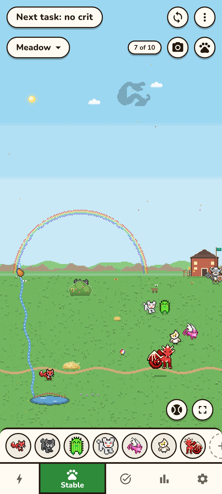

<h1 align="center">Sidekick for Habitica</h1>

<b>A crit planner and pet Stable for <a href="https://habitica.com">Habitica</a>, on Android.</b>

<a href="#install">Install</a> · <a href="#what-it-does">What it does</a> · <a href="#what-it-never-does">Privacy</a> · <a href="#problems-and-security">Report a problem</a>

   

Screenshots from the app's made-up account (Try it without an account).

See before you tap whether your next task will be a critical hit, and the cheapest honest way to make it one. Works for every class. Or switch crits off and keep the rest: your day at a glance, the warnings that protect it, and a playground where your pets and mounts live.

Sidekick for Habitica is an independent, open-source app. It is **not affiliated with or endorsed by Habitica**.

## Install

Android 9 or newer. The app is English only.

- **[Obtainium](https://github.com/ImranR98/Obtainium)** (recommended): add `https://github.com/VladB137/sidekick-for-habitica`. Obtainium installs the newest release and tells you when there's an update.
- **By hand:** download the APK from [Releases](https://github.com/VladB137/sidekick-for-habitica/releases/latest) and open it.
- IzzyOnDroid and F-Droid are planned.

The app never checks for updates itself and never talks to any server but habitica.com.

To try it before giving it anything, tap **Try it without an account** on the first screen: the whole app runs on a made-up account, answered on your phone by Habitica's own game code. Nothing is sent and nothing is kept.

## What you need

Your Habitica **User ID** and **API Token**: on the website, Settings → Site Data; in Habitica's Android app, Settings → My Account → API. The login screen has a button that opens the right page.

**The API Token works like your password.** Sidekick sends it only to habitica.com, directly from your phone. With "Remember on this device" ticked, it is kept on the phone, encrypted with a key held by Android's Keystore and left out of backups; untick it on a shared phone. Logging out deletes it. **Never paste your token anywhere else**: not in a bug report, a chat or a message to anyone, including whoever made this app.

## What it does

- **Two modes.** *Full* plans crits. *Relaxed* is for players who don't care about crits: it keeps everything else and never mentions them.
- **Crits, planned** (Full). Habitica's crit roll is not random: it is computed from your numbers, so Sidekick knows whether your next task crits, and lists the ways to make it certain, free first: a task you've already done, a gear swap, a stat point, a skill, a little Gold. You confirm every step.
- **Your day.** What matters right now in the character's speech bubble; Dailies left and the time to the day change; a warning, with what to do, before the day change would take all your HP; streaks at risk; quest invitations; drops left.
- **Tasks.** Score habits, Dailies and To-Dos, tick checklists, buy rewards, with what each one gives. Undo for mistaken taps.
- **Your class.** What your class is best at, worked out for your numbers and the gear you own.
- **Repeating To-Dos.** A To-Do that comes back a set number of days after you tick it, with a reminder.
- **The Stable.** Up to seven playgrounds, each with up to ten of your own pets and mounts living their lives. It also comes as a live wallpaper, a screen saver and a widget.
- **On the phone**, each one off until you switch it on: an ongoing notification with the verdict and the lines you choose, a widget, a Quick Settings tile, and Night gear, which puts on your best INT or CON gear before your day change and your own gear back after it.
- **History.** A calendar per Daily and habit, and the crit journal with your records.
- **Back up to a file** (Settings → Account) to move to a new phone. The file never holds your token or User ID.

Everything in detail: [docs/details.md](docs/details.md).

## What it never does

- Never sends anything anywhere but habitica.com. There is no server, no analytics and no ads.
- Never spends, scores or buys without your tap. The one exception is Night gear, if you switch it on: it changes the gear you wear, and nothing else.
- Never suggests tricks: no fake tasks or rewards, no padded checklists, no uncheck-and-recheck, no day-change or time-zone dodges, no stat edits. It never scores a task you haven't done.
- Never reads Habitica more than once every 30 seconds by itself, and it backs off when Habitica asks it to.

## Notification and refresh on some phones

Some phone makers stop apps in the background, which can freeze the notification or the 15-minute refresh. If that happens, [dontkillmyapp.com](https://dontkillmyapp.com) has the steps for your phone. Settings → On this phone has the ones for Android itself.

## Habitica's rules for third-party tools

Sidekick follows Habitica's [API Usage Guidelines](https://github.com/HabitRPG/habitica/wiki/API-Usage-Guidelines): every request names the app (`x-client`), automatic reads stay at least 30 seconds apart, and the app slows down when Habitica says so. Problems with Habitica itself go to Habitica, not here.

## Problems and security

- **A bug:** Settings → About → **Report a problem** opens a bug report with the app's and the phone's versions filled in, nothing from your account. Or open an [issue](https://github.com/VladB137/sidekick-for-habitica/issues/new/choose).
- **A security problem:** report it privately, as [SECURITY.md](SECURITY.md) says. Please don't open a public issue.

This is a hobby project, maintained on a best-effort basis.

## How it's built

Built with Claude Code, checked case by case against Habitica's own code (see the parity suites in [docs/details.md](docs/details.md#how-it-is-verified)). The engine is a line-by-line port of Habitica's game rules, compared result by result with Habitica's real code on every change, and the Android app is a Capacitor shell around the same TypeScript. Building, testing and releasing: [docs/details.md](docs/details.md#development) and [docs/releasing.md](docs/releasing.md).

## Credits and licences

- Sidekick for Habitica: [GPL-3.0-only](LICENSE), because the engine is a port of [Habitica](https://github.com/HabitRPG/habitica)'s code, which is GPL v3 without "or later". The app icon was drawn for this app and is under the same licence.
- Item, skill, pet and mount artwork and game data © HabitRPG, Inc., [CC BY-NC-SA 3.0](https://creativecommons.org/licenses/by-nc-sa/3.0/), from [habitica-images](https://github.com/HabitRPG/habitica-images), bundled with the app. Sidekick is free and non-commercial. The artwork stays under its own licence, not the GPL: see [LICENSE-ASSETS.md](LICENSE-ASSETS.md).
- Material Icons © Google, Apache License 2.0. Roboto and Nunito, SIL Open Font License 1.1.
- fdlibm sine © 1993 Sun Microsystems, freely redistributable with notice.
