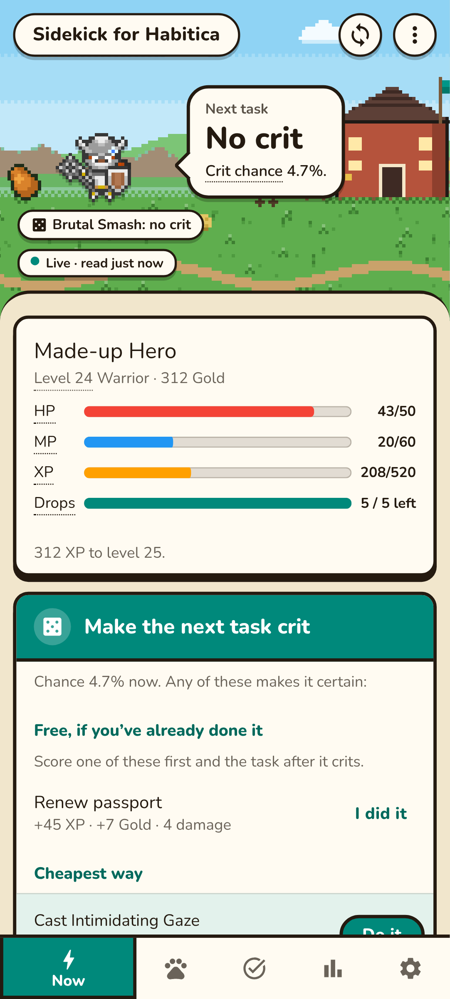
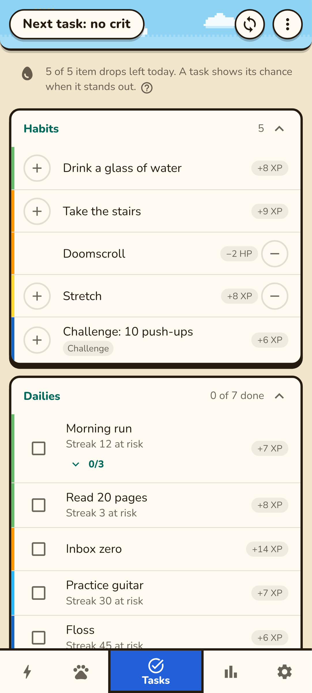
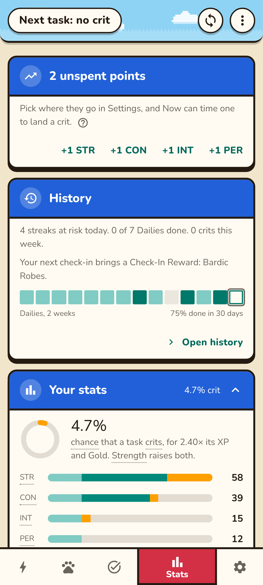
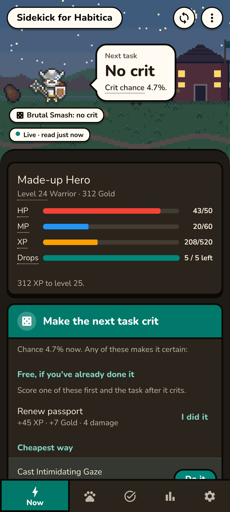

# Sidekick for Habitica in detail

Everything the app does, how it is verified and how to work on it. The short version for players is the [README](../README.md).

**A crit planner for Habitica.** See before you tap whether your next task will be a critical hit, and the cheapest honest way to make it one. Works for every class.

> **Status.** The Android app is the product and is in progress (milestone 2: the same code in a Capacitor shell in `android/`, plus an ongoing notification, a widget and a Quick Settings tile). CI builds a debug APK, which runs on the owner's Android 9 phone; other phones and Android versions are checked against the code only so far. This repository's web build is its test target; the GitHub Pages deploy is switched off (run *Deploy to GitHub Pages* by hand to publish a build that passed CI).

> **Your API Token.** Sidekick needs your Habitica User ID and API Token. The token works like a password. It is sent **only to habitica.com**, directly from your device. With “Remember on this device” (ticked on the login screen to start with; untick it on a shared device), it is stored on that device until you log out — in the Android app encrypted with a key held by Android’s Keystore (excluded from backups), on the website in the browser’s storage for this site — with a copy of your last numbers and tasks so the app opens instantly, and the crit journal; otherwise it is forgotten when you close the app. If Habitica stops accepting the token (you reset it), Sidekick deletes both and asks you to connect again; your crit journal and repeating To-Dos stay on the device for that User ID (logging out yourself deletes them too). It is never written to a log, the app's own Android logging included. Sidekick has no server and collects nothing.

Sidekick for Habitica is an independent, open-source tool. It is **not affiliated with or endorsed by Habitica**.

<p>   </p>

<sub>Screenshots use a test account on a local stand-in server.</sub>

## Why crits can be planned

Habitica’s critical hit roll is not random. The server adds up ten of your numbers — HP, MP, XP, gold, level, unspent points and your four allocated stats — and computes `frac(sin(sum + 1) × 10000)`. If that is at most `3% × (1 + STR/100)`, your next task crits (Brutal Smash uses CON, Burst of Flames PER, Backstab STR with a 30% base). Since August 2026 every one of those numbers is a whole number, so the roll is known in advance. Anything that changes one of them by a known amount moves the roll to another known value.

## What it does

**Two modes**, chosen after login (again after each Log out, nothing preselected) and switched any time in **Settings → App mode** (the first Settings card): **Full** is everything below; **Relaxed** is for players who don't care about crits. Relaxed keeps the Stable, stats, history, item drops and the warnings that protect your day, and drops everything that plans, forces or explains a crit: the verdict and the ways to crit, skills, gear swaps and their put-back, the class card's gear, skill and Smash plans, selling, the crit dial and tables, the prediction check, the crit journal, a landed crit's sparks and the Stable's crit confetti, and the Crits and Items and gear cards in Settings. Crits are never mentioned there, not even in the tap-to-explain words or the task chips (which show plain XP). Its class card is a plain one with no buttons: the class's own number and the stat that raises it in one line (a Warrior's boss damage waiting and STR, a Mage's XP to the next level and INT, a Rogue's Gold and PER, a Healer's HP and CON), and for a Healer the HP left after the day change and the party's lowest HP; any class with more MP than its max is told the next task drops it. Its app bar is never amber and turns red only when the day change would take all your HP. Relaxed opens on the Stable; the five tabs stay the same. On Android its notification has no crit line (Dailies left, the countdown and the bars come on by default, and its line choice is kept apart from Full's), the widget and the tile show your day, and Night gear pauses until you switch back to Full. Both modes read exactly the same from Habitica; switching sends nothing and keeps every hidden setting. The code asks for feature groups (`has('crit')`, `has('skills')`, … in `src/app/mode.ts`), not the mode. After the choice, three tips point at the parts that matter in that mode, each dismissed by a tap and never shown again by themselves (**Settings → About → Show the tips again**).

- **You, first on Now**: your Habitica avatar (background, mount, gear or costume, pet, drawn from Habitica's own images and layered the way Habitica's client does, in `src/app/avatar.ts`, which the Stable's riding reuses), your name, level, class and Gold, HP, MP and XP bars, the drops left today, and how much XP to the next level (below level 11, when class and skills arrive).
- **The character talks**: tap the character in Now's meadow and it says something (`src/app/sayings.ts`, all bundled), typed into its speech bubble letter by letter while it bobs and, for your avatar, opens and shuts its mouth (a helmet or a beard still covers it). A tap while it types finishes the line, a tap after starts another; a few seconds later the bubble shows what it showed before, and at once if that changes (a crit comes up, the connection drops). Relaxed never hears about crits; under reduced motion the line appears whole and nothing moves; TalkBack reads the line once. Nothing is sent to Habitica (`src/app/ui/talk.ts`). When the last due Daily of the day gets ticked (here or in Habitica, seen between two reads), the character sums up the day once, untapped: “All 8 Dailies done! 3 crits today added 41 Gold and 52 XP.” (the crits from the journal, Full only; Relaxed and a day without crits say “The rest of the day is yours.”); ticked on another tab, it says it the next time Now shows, that same day (`daySummary` in `src/app/headline.ts`). Among its facts is the next Check-In Reward, in Habitica's words (“5 more check-ins to your next Check-In Reward: Royal Purple Potion.”, `src/app/checkins.ts`, from Habitica's `loginIncentives.js` table in `src/data/items.json`).
- **What the app bar says on Now** (`src/app/headline.ts`, tested by `tests/headline.test.ts`): the one most important thing right now, in this order: offline, out of HP or a new day waiting, checking (Full), a crit waiting (Full, amber), the day change taking all your HP (red, naming the Dailies to finish first), no crit (Full), the day change leaving 10 HP or less, Dailies still open in the last 4 hours (naming them and the longest streak at risk), a quest invitation waiting for your answer (the quest starts only once everyone has answered; you Accept or Reject it in Habitica), your boss hit waiting, quest items found today, stat points to spend, a pet the food you hold raises into a mount, new pets your eggs and potions hatch, the next level within 10% of its XP, and otherwise Dailies left and the time to the day change. Full keeps the crit verdict as the headline unless the day change would take all your HP and no crit is waiting (a crit keeps it even then, with the warning below it), and puts the day's most important fact (from the low-HP warning to quest items, a quest invitation included) in the line under the verdict. Relaxed says the first fact and never a crit. Every number comes from the engine, as on the cards below.
- **Now**: the verdict for your next task and every class skill roll. When the next task crits, the done tasks that make the most of it (you confirm “I did it”). When it doesn’t, the ways to make it certain: the cheapest one first, highlighted with the only raised button, then the others **free first, then cheap, then costly, last resorts last**, folded under “Other ways”, each tagged with its tier:
  - *Free*: tasks you may already have done that set up a crit for the task after them; a gear swap, or your best set for the roll's stat (put back by itself once the crit is used); a stat point into the stat you chose; buying something you were saving for.
  - *Cheap*: mana, a little Gold (up to 3% of yours, at least 10), spare items.
  - *Costs something*: more Gold, eggs, potions and food your pets and mounts still need (valued at what they’d cost to buy back: the Market price in Gems), rare items you have spare.
  - *Last resort*: rare items (quest eggs, magic and wacky potions) your stable still needs.
  - *If you’ve already done it*: a task you haven’t ticked yet plus one other step, after everything that needs nothing from you (you confirm you did it).
  Your class skill's own roll (Brutal Smash, Burst of Flames, Backstab) has a **Make it crit** button on its row in Skills: a sheet with what makes the next cast crit and still leaves the mana to cast it. Each option shows its net Gold, mana and items. Before one runs, Sidekick re-reads your account; if anything moved you get fresh options instead, and it stops at the first step Habitica refuses. Burst of Flames aims at your bluest task, which its XP grows with, and its row says how much XP the cast gives there. Skills that can crit come first; the rest fold under “Other skills”. 
- **Your class** (a card on Now from level 10, folded to its title and one line until you open it): what your class is best at, worked out for your numbers and the gear you own. Every action in Habitica reads your stats at that moment, buffs keep the size they were cast with until your day changes, and taking INT gear off doesn't cut your MP, so the right gear differs per action ([docs/class-strategies.md](class-strategies.md)):
  - *Warrior, boss damage*: every Brutal Smash your MP pays for, in your gear and in the owned set (STR, CON or both) that does the most damage, with each crit known in advance; one tap casts them one request at a time, in that set, and puts your gear back after.
  - *Mage, XP and the party's mana*: Earthquake and Ethereal Surge at their biggest, and how many Brutal Smashes a Surge gives each Warrior in your party.
  - *Rogue, Gold*: Tools of the Trade, Stealth and Pickpocket at their biggest.
  - *Healer, survival*: your HP after the day change (your own open Dailies, CON included, and your share of the boss's damage), the set that cuts it, your party's lowest HP, and Protective Aura, Healing Light, Blessing and Searing Brightness at their biggest (Brightness steps up at INT 14, 41 and 121).
  - *Everyone*: the owned set that makes your next task pay the most toward your aim; banking mana in INT gear (a higher cap and more MP at the day change); a warning when your MP is above the cap of the gear you wear, because scoring a task would cut it.
  "Wear it" re-reads first and swaps piece by piece; a banner puts it back. Nothing is cast or scored without a tap.
- **Drops** on Now's you card: item drops left today as a meter.
- **Your pets, and a crit that feels like one**: one of your own pets (the one out, else one you've hatched; the bundled sprites, no request) says so on Now's you card once every Daily due today is ticked, and naps on the offline card. A crit Habitica confirms bursts amber sparks from what you tapped and counts its XP and Gold up in the snackbar; a ticked box draws its tick and bars glide to their new length. The card that answers "what now" stands higher than the reference cards, and numbers use tabular figures. All motion is off under the system's reduced-motion setting.
- **Live, checking, offline** — three looks that can’t be confused. *Live* (read from Habitica within the last 90 s): teal, or amber when the next task crits; amber only ever means “verified, act now”. *Checking* (a saved copy, or back from another app): no amber, “Checking…” until Habitica answers. *Offline*: a blue-grey bar, the verdict in the past tense with its time, no action buttons anywhere, read-only tasks, nothing queued.
- **Automatic, within Habitica’s rules**: a re-read every 60 s while the app is on screen (one request; automatic calls stay ≥ 30 s apart; tasks are re-read only if the numbers moved); the day starts by itself when there’s nothing to record, as Habitica’s web client does (it re-reads the tasks first, so a Daily added elsewhere is still asked about); when Habitica still has the account on another time zone than the phone's (after travel or a clock change, until Habitica's own app is opened), Now and History say so, since days change by the account's clock; swapped gear goes back once the crit is used (if Habitica refuses either, the app tries again a minute later, not at once); a banner when Habitica runs a newer version than the rules were checked against, read from the version Habitica already sends with every answer, with a **Get the update** link that opens the newest build in the browser (the app itself still talks only to habitica.com). Scoring, buying, selling and stat points are never automatic.
- **Tasks**: score habits, Dailies and To-Dos, tick checklists and buy rewards, with each task showing what it would give and a labelled “sets up crit” mark when the task after it would crit. In a crit every open task's XP chip turns amber, and the one with the biggest payoff for your aim says BEST and shines. Undo for mistaken taps. A bad habit's “−” logs it without asking (your own tap, as in Habitica's apps): Habitica can't undo a habit scored down, so the log waits 5 s with Undo in the snackbar and goes when that runs out or you leave the app; a bad-only habit shows what it costs (“−2 HP”, from the engine). While a score is on its way only that row waits; a tap on another row says “One moment…” and sends nothing. Challenge and team tasks are marked (skills can’t target them); Dailies on a team board never count toward your own day change (Habitica's day change and Stealth see only your own tasks). A task shows its exact **item drop chance** (Habitica's own formula, with the crit that score would land) when the aim is Drops, or when its chance stands out (a crit, or at least 1.5 × the median of the open tasks), and the top of the list says how many of today's drops are left (5 + PER/25 + contributor level, doubled for subscribers); once they're used up, a collection quest's item chance is shown instead. Which item drops is luck: the server picks it with true randomness, so the app never claims to know. A drop shows in the snackbar (“found Strawberry”).
- **Repeating To-Dos** (a card on Tasks): a To-Do that comes back a set number of days after you tick it — water the plants a week after you last did, change the sheets every two weeks. Habitica has no such task (a Daily’s “every N days” runs on a fixed rhythm and costs HP when missed); here a late one just waits like any To-Do. You make the template in a full-screen editor (title, notes, difficulty, checklist, 1–365 days, with the day it would be back shown as you change it), from scratch or from one of your open To-Dos. It is kept on this device (needs “Remember on this device”; logging out deletes it). When it is back, Now and Tasks say so, and on Android a reminder comes at 9:00 on the phone's clock (or when your Habitica day starts, if later) on its own notification channel, with **Add to To-Dos** and **Tomorrow**. **One tap adds a fresh copy to Habitica; nothing is ever added without that tap**, and editing a template never changes the copy already in Habitica. A tick is noticed from Habitica’s own list (in the app, and on the phone from its background reads); a copy that disappears is looked up among your ticked To-Dos (one automatic read, 30 s after any other; a refused one waits a minute) to tell a tick from a delete, and a deleted copy pauses its template; on the phone a reminder for such a copy waits for that same read, so a deleted To-Do never comes back as “is back”. Days are counted in your Habitica account’s time zone, as Habitica’s day change counts them. While an add is on its way, from the app or from the reminder, neither offers a second Add. Adding a To-Do moves none of the numbers the crit roll reads.
- **Stats**, friendly first: stat points, **History** (today's Dailies done, streaks at risk, this week's crits, the next Check-In Reward and how many check-ins away, and the last two weeks of all Dailies as one row of squares with the share of due days done in 30; a tap opens History), **your stats as bars** (each one split into level, gear, points and buffs) with your task crit chance as a dial, the gear you wear, the Stable card (a still picture of the open playground at this hour and season, with what the account has grown and whoever lives there, painted once from the art the app ships with like the Stable widget's pictures (your avatar isn't drawn on a ridden mount there), with its name and how many live there; until you choose anyone that is your current pet and mount, as in the Stable; a tap opens the Stable), a **feeding and hatching plan** (which pets the food you hold raises into mounts, favourite food first and smallest stacks first; what each growing pet still needs; which eggs and potions to hatch, new pets and mounts before pets you raised already, each egg showing its pick first and opening to every pet it can hatch into with the potions you hold; each pet drawn from the sprites bundled with the app, so no picture is fetched from Habitica; advice only, you feed and hatch in Habitica), items to sell (spare vs. what your stable needs) and things you’re saving for (only what Habitica sells you for Gold right now), with **Worth buying** under them: up to three pieces of gear on sale that raise what your own open tasks give toward your aim, each tried in the best set you’d own with it (crits weighed by how likely they are, in Full), best value for the Gold first, with **Save for it** (advice only; buying stays a tap). The workings fold into one card at the end, **How the numbers work**: the stats Habitica’s server actually uses (the Android app shows class gear at half value), every crit chance, how the roll works, how a gear swap makes a crit, and a running check of every prediction against Habitica’s answer (shown once there is a first prediction).
- **On this phone** (Android app, Settings; each off until you switch it on, and only with “Remember on this device”): an ongoing notification with the verdict and the lines you choose (**Settings → What the notification shows**: crit verdict, a quest invitation waiting (on by default; it needs nothing but the usual read), Dailies left, day change countdown, boss HP and your pending hit, collection quest progress, HP/MP/XP bars, stat points, what you're saving for, night gear; Automatic order puts a crit, being out of HP and Dailies still open late in the day first; up to six rows, each up to three lines, as many as fit whole in the height Android gives an expanded notification at your text size, with the bottom line saying how many didn't fit; a live preview with your numbers, drag to reorder, optionally the same first two lines on the widget; the Dailies line reads `GET /tasks/user?type=dailys` only after your numbers moved, the quest lines read `GET /groups/party` only while you're in a running quest, each at least 30 s after the read before); a re-read each time the Habitica app closes (needs usage access, which only you can grant); a re-read every 15 minutes; a home-screen widget and a Quick Settings tile (a tap reads once); and a **Stable widget**: a still picture of the open playground (its scene, what has grown, who lives there and where; the same in both modes), in the light of the phone's hour (dawn, day, dusk or night, swapped at each change by an alarm that doesn't wake the phone), opening the app on the Stable when tapped. Widgets can't run the playground, so the app paints the four pictures from art it ships with (never the live stage, whose rider comes from Habitica's image server) while a Stable widget is on the home screen, and again only when something they show changes; your avatar isn't drawn there, on a mount or on foot, and party visitors never are. It never reads Habitica, keeps its pictures only with “Remember on this device” and loses them at logout. The **Stable wallpaper** (Settings → On this phone → Stable wallpaper → Set, then Android's own Set button) puts the open playground on the home screen, moving: the creatures wander, hop, trot, bound, scoot or hover by their gait, keep company and play as in the Stable (greetings, little ones following, tag, the line home, snow huddles, fireflies, night watch, your pet beside your mount, the signature pairs; not the touch extras), head for the stable at dusk and sleep with Zzz at night (owls stay up, and so does the mount you ride), your avatar rides the mount you're on in Habitica or else stands by the stable's door and gets greeted now and then (in the Inn it sleeps there, the light dims and the herd sleeps by the door), and a tap on one gives a happy hop and a heart; snow, leaves, fireflies or the glade's glow fall over it by season, the scenery's own critters and shooting stars live there as in the Stable, and the scene follows the phone's hour. The phone can't run the playground's canvas, so the app paints the scenery once per light of the day (the scene, the trees creatures walk behind, each creature's picture, from art it ships with) while the Stable is the wallpaper, and again only when what it shows changes; the phone moves the creatures, the weather and the critters with a Java port of the playground's own code (`android/verdict` `StableHerd`, `StableWeather`, `StableAmbient`), seeded like the Stable so they start where they stand there. To spare the battery it runs only while visible, steps at most 30 times a second on a timer, skips frames where nothing visible moved, stops while the screen is off, and is a still picture with Android's animations off or Battery Saver on, the same as the app's (still poses such as the Lion lounging low, perchers up at their places for the hour), moving again as soon as they are switched back. Whatever order Android reports the wallpaper's surface, visibility and the screen in, a visible wallpaper keeps moving (`StableLoop`), and a frame that fails starts the herd again instead of taking the app down with it. The avatar's pictures come from Habitica's image server, as on the Now screen: the app's canvas can't read them, so the phone fetches them itself, once per look, keeps them beside the scenery, and fetches again later if it was offline. Same in both modes, it never mentions crits, never reads Habitica's API, and keeps its scenery only with “Remember on this device”, losing it at logout. The **Stable screen saver** (Settings → On this phone → Stable screen saver → Choose opens Android's Settings → Display → Screen saver, where you pick “Sidekick Stable”) shows the same moving playground, from the same scenery, with a large clock in the sky and the day under it (12 or 24 hours and the language as the phone tells the time; dimmer at night, drifting a few pixels each minute so an OLED screen doesn't keep the same digits lit). Android starts it only while the phone charges or is docked, as you set there; it ends when the charger comes out or the screen is touched, whether or not the Stable is also the wallpaper. Both run on one `StableStage` (the herd, the weather, the timer and the drawing), so anything the wallpaper shows the screen saver shows too; on a screen wider than tall, both centre the meadow's walking band. A Live line turns to Checking by itself 90 s after its read on every surface (the out-of-HP and new-day lines too), the notification comes back after a restart or an update, and logging out or switching the notification off removes it. If Habitica refuses the remembered login, every surface says “Habitica no longer accepts your login. Open the app to connect again.” and the phone stops reading (the notification's service and the 15-minute job included) until the app's next successful read or a new login; a Checking line names a Habitica server error (“Habitica isn’t answering”), and a tile tap that couldn't read says why (wait a few seconds, Habitica asked to wait, log in again). When Android blocks the app's notifications, Settings says so with a button to Android's settings, and the notification's service stops until they are allowed. The service redraws when a read lands and once a minute while the screen is on, and looks for Habitica closing only with usage access, every 5 s, screen on; the 15-minute refresh skips a period when nothing on the phone (notification, widget, tile, repeating To-Do) would show it. A late answer never overwrites a newer read, and nothing a native read or night gear step was still waiting for is written after logout. Logging out while night gear is on asks first: “Put it back and log out” equips what you wore before (your tap), “Log out anyway” leaves the night gear on. They show the same verdict as the app, worked out on the phone by a Java port of the roll that is tested bit-for-bit against the engine, and they only ever read: anything that spends or scores is a tap in the app. **Night gear** is the one exception that changes something without a tap, and it only equips: at a time you set, the phone puts on your best owned INT gear (more MP kept at your day change) or CON gear (less damage from missed Dailies; Automatic picks CON while Dailies are still open and you aren't resting in the Inn), then puts your gear back at a second time, never before your new day has started; a night the phone runs more than 2 hours late (switched off, battery saving) is skipped, so the gear can't land after the day change and stay on all day (Habitica runs the day change only when a client asks, with the gear worn then). It works from the app's last read and leaves your gear alone if it isn't what the app saw, or if you changed it after the swap. The logic is `android/verdict/.../NightSwap.java`, tested against Habitica's own equip and cron in the mock server. **Keep running on this phone** explains battery savers that put the app to sleep and stop all of this (where the switch is on any phone, and on Samsung, Xiaomi and Huawei, with a link to dontkillmyapp.com for the rest); the app can't change that setting itself.
- **History** (from a card on Stats; Back returns to Stats; Streaks at risk, Dailies, Habits and the crit journal each fold): read from the history Habitica keeps with every habit and Daily, no extra request. *Streaks at risk*: due Dailies left unchecked whose streak the coming day change resets, with what protects one (resting in the Inn, Chilling Frost, Stealth); Tasks marks them too. A calendar per Daily (done, done when not due, missed, not due, no record; the completion rate over the last 30 days) and per habit (how often + and −), up to 13 weeks back; three of each show first (Dailies with a streak at risk, then the longest streaks; the habits scored on most days), the rest under “All Dailies” and “All Habits”, on your own day start and time zone; Habitica keeps day-by-day history for 60 days, a year with a subscription. The *crit journal*: every crit scored in Sidekick, with its multiplier, what it added over the same score without it (Gold, XP, mana, boss damage while a boss quest is on), whether a suggestion set it up, and weekly totals. *Crit records* head it: the biggest multiplier, the most crits in one day, the most days in a row with a crit (and the run going now), and every crit together with what they added, kept with the journal and carried crit by crit, so they outlive the journal's oldest entries (it keeps the latest 1,000). It is kept on the device only with “Remember on this device”, cleared (records too) on logout or with a tap; crits scored in Habitica's own app aren't seen.
- **Settings** (its own tab, its labels asked as questions): *App mode* first, then *Crits* (what crits should help with most, where your stat points go, which task Brutal Smash hits, and which ways Sidekick may suggest: one row that opens the switches), *Items and gear* (a minimum to keep of each item, protecting what your stable needs, putting gear back by itself), theme, **who talks on Now** (your avatar, or any pet or mount you own, chosen in the Stable's picker with one choice; it stands where the avatar would, facing the speech bubble: the avatar without its Habitica background, a mount at Habitica's scale, a pet half as big again; one the account no longer owns gives way to the avatar and comes back with it), vibration on crits.
- **Moving to a new phone** (Settings → Account): Android's own backups stay off so the token never leaves the phone, which means what the app keeps only on the phone (repeating To-Dos, pet and mount names, playgrounds and toys, the Stable's growth, the crit journal and its records, the weekly almanac's week record, the prediction record, settings) would be lost with it. *Back up to a file* writes all of it as one JSON file, through Android's save dialog on the phone (Downloads, a cloud drive: the player's choice) or as a download on the website; *Restore from a file* reads one back after asking, replacing what this phone keeps for the account. The file never holds the API Token, the User ID or the saved copy of the account the app opens with; the account is named by a one-way tag (16 hex digits of SHA-256 over the User ID), so a file from another account brings the settings, names and playgrounds but not its journal, records, growth or week record, and its repeating To-Dos come back as ones to add with a tap. The mode chosen at login and Night gear stay as they are on this phone. Nothing is sent to Habitica either way (`src/app/backup.ts`).
- **Report a problem** (Settings → About): a sheet shows the lines a bug report starts with (app version and build date, the rules and item tags, Habitica's reported version, Android and WebView versions and the phone's model, screen size, mode, connection, how many predictions matched and, for the last miss, what it was and which values differed, never the values or the task's words), with *Copy* and *Open GitHub*, which opens the repo's bug form (`.github/ISSUE_TEMPLATE/bug_report.yml`) in the browser with those lines filled in. Nothing from the account goes in, and the app itself sends nothing (`src/app/report.ts`).
- **Start of day**: asks about exactly the Dailies Habitica’s web client would (due yesterday by Habitica’s own schedule rules, ported and tested), the Start new day button after the list (it stays in reach and says how many will count as missed and the HP that costs, by the same day-change calculation as the Inn advice), records the ticked ones and runs the day change — and scores nothing if another app already started the day.
- **Before the day change takes all your HP**: when your own open Dailies and your share of the boss's damage would leave you at 0 HP, a card leads Now with the fewest Dailies to finish (biggest loss first, by name), your best CON set if it helps (the day change counts the gear worn then), the Health Potions it would take and a Buy one button, and what resting in the Inn would do: pausing damage in Habitica's Settings before the day changes stops your missed Dailies hurting you, keeps streaks, gives no mana at the day change and holds your boss damage and collection finds, while party members' missed Dailies still reach you through the boss. That last one is advice only: Sidekick never pauses damage for you and never ranks it as a suggestion. Not shown while a day change is already pending, and gone while you rest. The same calculation (`dayChangeDanger` in `src/engine/daychange.ts`) is there for anything else that needs to say "tonight would kill you".
- **Out of HP**: everything pauses except reviving, and the revive sheet names exactly which stat point and which piece of gear Habitica will take (both are decided by your numbers).
- **Intro**: before the login screen, whenever nobody is logged in, seven swipeable slides: your Stable (the meadow with three of Habitica's pets), your days at a glance, the day-change warning and what the phone can show, the two crit slides marked *Full mode*, the two modes, and Get started; Skip or Get started opens the login screen. After the first login on a device (existing installs included), and after every login that follows a Log out, comes the mode choice, two cards with nothing preselected. A token Habitica stopped accepting goes straight to the login screen, which says why, and keeps the mode. On the login screen, **Open Habitica settings** opens Habitica's own Android app on its Settings screen when it's installed, and Habitica's API page on the website when it isn't (or on the website build).
- **Try it without an account**: under Get started on the intro's last slide, and in a card under the login form, opens the whole app on a made-up account (a level 24 Warrior with tasks, a party in a boss quest and a Meadow of pets), so you can see it work before handing over a token. Habitica's own game code answers every request on the device, through the same stand-in for habitica.com the tests use (`tools/mock/habitica-mock.mjs`, with Habitica's real limit of 30 requests a minute); nothing goes to Habitica (only the avatar pictures load from Habitica's image server, as for any account). It is the same app as after a login, mode choice and tips included, with a banner on every screen saying so and a **Use mine** button back to the login screen (Settings' account card and the menu lead back too). Nothing of it is kept: the device's storage is set aside in memory for the visit, the Android side (Keystore, notification, widgets, tile, wallpaper, night gear) is never asked for anything, a reload starts it over and closing the app forgets it. Habitica's code and English text (about 1.5 MB, 400 KB compressed) are a chunk of their own, loaded only on the tap and left out of the website's offline copy (`src/app/demo.ts`, `src/app/demo-account.ts`, `virtual:habitica-game` in `vite.config.ts`).
- **Login, step by step**: a button opens Habitica's page with your User ID and API Token (the Habitica app's path is listed too); paste buttons on both fields, and one paste holding both codes fills both; each field says as you type whether it looks right (36 characters with dashes) or how many characters are missing; the token note is two lines, with the rest under More.
- **Habitica's words, explained**: the app keeps Habitica's own terms (crit, HP, MP, XP, STR, CON, INT, PER, buffs, day change, bluest task, drops, streak…), underlined where they appear on Now, Stats and History; a tap opens one or two sentences from `src/app/glossary.ts`.
- **Stable** (second tab, and a card on Stats that opens it full screen): the pet playground. One playground per scene (so up to 7), each called by its scene's name and holding up to 10 residents, pets and mounts mixed, chosen from what the account owns. Under the app bar, floating on the meadow as outlined pills and round buttons like the app bar's own, sit the playground's name (it opens a menu with a thumbnail of each playground, New playground, Change scene, Delete, What grows here and Go into the barn; New playground and Change scene offer only scenes no other playground has, and a changed scene brings its name, with everyone living there and Undo), the count, the postcard camera and the picker; the switch to another playground is a 4 × 4 dither dissolve (an instant cut under reduced motion). The picker is a full-screen dialog with Pets and Mounts tabs, search, tiles grouped by species and the chosen creatures as chips; pets raised into mounts aren't offered. A creature lives in one playground at a time: its tile says where, and choosing it moves it here, with Undo. The row under the meadow has a chip per resident (a real button, so TalkBack reaches each one) that opens its sheet: Name, Find, Pet, Ride (mounts only), Move to another playground, Remove, with what it is, where it lives and how many days it has been in your playgrounds. **Names**: every creature gets a name the first time it lives in a playground, from a hand-written list themed by its egg and hatching potion (`src/data/pet-names.json`, about 800 different names, in an order seeded by the account so two players' Red Wolves usually differ; no two creatures on an account share one), and the snackbar says hello with a Rename action. Name, on its sheet, takes up to 12 letters (accents and Romanian letters included), offers three ideas from the list with a dice for three more, or Use Habitica’s name. The name shows over its head for a moment, in the scene's own pixel font (`src/playground/font.ts`, the same on every WebView) on a dark plate: after a tap, a stroke, Find or Pet, while it's carried, and when up to three creatures move in; never on the widget or the wallpaper. It also names the creature in its sheet and chip, the picker (search finds names too), the snackbars, TalkBack and the feeding plan ("Ruby (Red Wolf)"). A pet raised into a mount passes its name on; a pet hatched again while its grown-up keeps the name is "Little" that name. Names are kept on the phone only, per account, next to the picks (`src/app/stable/names.ts`; lost on reinstall, like the picks), and are never sent to Habitica, which has no names for pets. Habitica's own names are its words, special creatures included (Cerberus Pup, Turkey, the Tiger a Tiger Cub grows into). Until you choose anyone, the Meadow is simply your current pet and mount from Habitica's last read. A pet raised into a mount or released in Habitica leaves its playground on the next read, with one snackbar (a raised pet offers to add its mount). Who lives where, and where you dropped them, is stored on the phone only, per account (`src/app/stable/picks.ts`); picking never calls Habitica. **Riding** is the Stable's one Habitica action, a tap on a mount sheet's Ride: `POST /user/equip/mount/{key}`, which spends nothing. Habitica's equip toggles, so Ride is sent only when the last read says you aren't on that mount and Get off only when you are, only in the Live look (Checking waits, Offline says riding needs Habitica), one call per tap and never retried; the snackbar says what Habitica's reply reports, with Undo (another tap: the previous mount back on, or off again). When the mount you ride lives in the open playground, your avatar rides it, layered as Habitica's avatar component does (mount body, your avatar from `src/app/avatar.ts`, mount head, placed from the mount's own image, Kangaroos 24 px lower), its chip wears a saddle badge and it never falls asleep (`src/app/stable/ride.ts`). **On foot**: when it rides nothing in the open playground, your avatar stands beside the stable's door (Habitica's avatar pictures without mount or pet, a snowball, ghost, flower or starfish as Habitica shows them); now and then a creature walks over to greet it with a heart and it hops, and a tap on it calls the nearest awake creature over. While you rest in Habitica's Inn your avatar sleeps with Habitica's own sleeping face and Zzz, the stable dims to dusk's light and the herd sleeps by the door whatever the hour. **Party visitors** (`src/app/stable/visitors.ts`): now and then a party member's creature walks in from one side, mixes with the herd for one to two minutes and walks out again, at most two at a time, everyone getting a turn: their mount with their avatar in the saddle if they ride one the Stable can draw, else their current pet. A tap shows whose it is (“Ana's Golden Fox”, the name kept to letters the meadow's font can write), TalkBack hears who is visiting, and a visitor can be petted or carried but never stays. They come from the party members the app already reads with the party (at most every 5 minutes; Habitica's reply carries each member's public items and avatar look), so nothing extra is asked of Habitica; other players' names and looks stay in memory only, and never reach the widget or the wallpaper. None arrive from bedtime to morning or while you rest in the Inn, and with reduced motion the first two simply stand in the meadow. **Postcard**: the toolbar's camera stops the meadow where it stands (a white blink, none under reduced motion) and puts that frame, without the app's buttons, on a white card with Habitica's art credit written under it ("Pet, mount and avatar art © HabitRPG, Inc., CC BY-NC-SA 3.0, from Habitica. / Made with Sidekick, not affiliated with or endorsed by Habitica."), at least 1080 px wide (`src/app/stable/postcard.ts`). On Android, Share opens the phone's share sheet with that one PNG (kept in the app's cache, only the latest); in a browser it is saved, or shared where the browser can share files. The app uploads nothing, and the card shows only what the meadow shows. The meadow moves again when the card closes. **Weekly almanac** (`src/app/almanac.ts`): the card's sheet also offers *This week* and, once a week has been counted, *Last week*: the same frame with a parchment ribbon naming the week over the picture and the week written under it, above the credit: the crits and what they added (Full only), the share of Dailies done (from Habitica's own Daily history), the longest Daily streak, pets hatched, mounts raised and quests won. Habitica keeps no date for those last three, so the app keeps, per account on the device, what the account had at the start of each week and at its latest read (`src/app/weekly.ts`); a new week counts on from the last week's latest read, and the first week from the first read (the card says so). The first Stable visit of a new week offers last week's almanac once, in a snackbar. No task names go on it. On Android the avatar's pictures are fetched by the phone itself (no token, kept in the app's cache, wiped at Log out) so the canvas can be copied with the avatar on it; a browser can't copy them (Habitica's image server sends no CORS headers), so there the card leaves the avatar out (riding or on foot, and a visiting friend's) and says so. The creatures wander, walk head first in their own gait, sleep at night, chase the ball (up to three at once, taking turns to bump it back) and answer a tap with a heart; with nobody home, a note says how to bring someone in. **Each species has its own nature** (`src/stable/natures.ts`, one module per behaviour in `src/playground/behaviours/`): the night creatures (Owl, Hedgehog, Raccoon, Frog, Spider, Badger, Armadillo, Snail, Octopus, Jack-O-Lantern, Rat, Velociraptor) are up all night and nap in bouts by day; the Cat and the Fox are livelier at dawn and dusk and nap at noon; the Rooster turns in early and crows at dawn, notes rising from its head, waking whoever sleeps nearby; the Sloth crawls and sleeps most of the day; Lions lounge by the stable's door and the farm animals stay near home; Cheetahs and Velociraptors sprint now and then with dust at their heels, and Rats scurry; Guinea Pigs popcorn; Kangaroos and Jackalopes bound; the Crab walks sideways, toward the shore; the Egg wobbles; the Rock never walks on its own; the Cactus and the reptiles bask on the sunny open ground; the snow lovers (Wolf, Penguin, Mammoth, Sabretooth, Whale, Fox) are livelier in winter and bound through the snow, and bears nap through winter days by the door; Yarn rolls wherever it goes, the Armadillo and the Hedgehog curl up and roll now and then (and the Hedgehog curls up when you pick it up), the Otter floats on its back in the water, the Sloth climbs halfway up a tree (higher up a big one) and hangs there upside down, and the Penguin belly-slides in the snow, all of them turned by whole quarters so every pixel stays crisp (`src/playground/turns.ts`; never with a rider on). Some answer touch their own way: a tap sets the Ferret off on its war dance (sideways hops with turns), gives the Rock a heart and no hop, and wakes the Treeling with a shake and falling leaves (on the wallpaper and screen saver too); an Octopus or Cuttlefish picked up leaves a puff of ink where it sat, a dropped Slime splats flat with a spatter and pulls itself together, and a tap on the ground sends a Deer or Bunny bounding away instead of turning to look. With the ball (or a rolling toy), the Dog carries it back to where it was flicked from, the Beetle pushes it along in front of it like a dung beetle, the Cat stops short, crouches, wiggles and pounces on it before batting it away, and the Dolphin swims over to bounce it on its nose when it lies in the pond or a marsh pool (not a frozen one), then flips it back to the grass; a tap or the finger on the ball, or on the one playing, ends the game where it is. On the ground and at night: the grazers (Horse, Unicorn, Deer, Cow, Sheep, Alpaca, Mammoth, Triceratops) stand and nibble with a bit of grass flicking up, or paw at the snow in winter, and the Cow moos; the Bunny burrows out of sight, leaving a mound, and pops up a little way off; the Badger digs itself a hole; the Fox goes mousing in the snow, a high leap and a dive to the shoulders; the Raccoon rummages by the stable door and the lantern at night; the Jack-O-Lantern lights the ground around it from the evening on, the Phoenix glows warmer and gives off embers, and the Robot powers down for the night with a blinking light and beeps when tapped; the Dragon puffs a little flame from its nose now and then and when tapped, and on snowy evenings it stays put, glowing, and the others sleep in a ring round it instead of by the door; the Unicorn leaves a faint sparkle trail in the evening, the Snail a shiny trail that fades, and the TRex's steps puff dust; on a full-moon evening the Wolf stays out to howl at it and the creatures near it turn to look. **Trees, sky and flowers**: the Owl flies up onto a tree's crown or the stable's ridge at night and hoots; the Falcon perches by day and now and then swoops down and back up; the Gryphon, the Hippogriff and the Gryphatrice sit up there like they own the place; the Squirrel and the Monkey climb into a crown (the Monkey swings); the Spider climbs and lets itself down on a thread of silk, dangles and climbs back; the Pterodactyl soars into the sky above the trees and glides out and back; the Flying Pig flaps up to about the treetops and loops out and back, once or twice, but stays on its hover in the still picture; the Phoenix and the Dragon mounts (not the wingless Dragon pets) sail high on slow wingbeats in a wide figure, now and then; the Parrot hops up onto a crown or the ridge a short while and chatters; the Butterfly and the Magical Bee visit the flower patches Perfect Days grow, the bee leaving pollen; the Giraffe browses at a tree, leaves falling; the Panda Cub munches in the Bamboo grove; the Treeling stands among the trees as still as one. Every tree counts, the one on the horizon from the start and those the account grows; a tap on a creature up a tree gives a heart and it stays up. In the still picture (reduced motion, the widget, the Stats card, and the live wallpaper and screen saver with animations off or Battery Saver) whoever is awake and may go up at that hour is shown up there, one to a place, the nearest to where it stands: the Owl at night and the Falcon and the gryphons by day on a crown or the ridge, the climbers in a crown, the Sloth hanging, the Spider in its tree, the Parrot on a crown or the ridge by day, a butterfly or bee on the flowers, the Pterodactyl high in the sky; one put down by a finger stays where it was put. **Water**: the pond, the marsh's pools and the lake and the sea along the horizon are water (the pond and the pools freeze in winter and are walked on as ice). Anyone walking through water wades, drawn cut at the waterline with nearly a third of it under. The swimmers (Otter, Platypus, Penguin, Turtle, Frog, the Tigers, the Polar Bear Cub) now and then swim low in the water with ripples, or dive with bubbles and come up somewhere else; the sea creatures (Dolphin, Orca, Whale, Seahorse, Octopus, Cuttlefish, Nudibranch, Sea Serpent, Mantis Shrimp, Axolotl) swim longer and more often, and where there's no open water yet they rest more and wander less; Dolphins and Orcas leap out of the water in an arc and splash back, the Whale spouts, Alligators and Hippos lurk with only their top showing, the Frog sits on the marsh's lily pads and croaks, and bears fish from the bank while a fish jumps. Pets swim wherever they fit with room to spare, mounts only out on the lake or the sea, which they walk up off the meadow to reach, behind the horizon's trees there; a ridden mount never swims. At most 1 wander in 2 turns into one of these acts, and at most three creatures (or half the herd, when that is more) do one at a time. A nature is plain data, looked up by species, then hatching potion, then the creature itself (the Cerberus Pup keeps night hours, the Polar Bear Cub loves the snow and the water), and carries Habitica's own animal families; the wallpaper and screen saver get it with each creature's picture and run it the same way. **Together** (`src/app/stable/social.ts`, worked out from what Habitica already says, never grown by petting or time): each creature has a temperament from Habitica's word for its egg ("a loyal" Wolf keeps close, "a perfidious" Otter keeps to itself, "a mischievous" Cat starts games), and each pair at most one bond: family (a pet and the mount of the same key), kin (one animal, Lion Cub and Lion, the Cats family), best friends (creatures with neither, paired up in a seeded order), cousins (one of Habitica's animal sets) or look-alikes (the same potion). They walk over to whom they're bonded to, turn to face them and greet with a hop each, a small group of small hearts for family and friends or a sparkle for the rest, now and then leaning in; a little one follows its grown-up and copies its hop when you pet it; a creature with no saved spot starts beside its closest friend; family and friends sleep side by side by the door, breathing in step. A mischief maker starts a game of tag with a pet nearby (three or four tags, a hop and a sparkle each); at dusk the largest mount leads the others home in a line; in the snow they huddle (by day now and then, at night in one huddle), except Habitica's Polar Pro animals; summer fireflies make them turn to watch and mischief makers jump; night creatures sit beside the sleepers; your current pet walks beside the mount you ride. Signature pairs: a Cat pounces on Yarn, a Wolf or Dog herds two or more Sheep (a stray walks back), a Dragon keeps near an Egg facing outward and sleeps beside it, a Squirrel hops circles round a Treeling, Hedgehog, Cactus and Rock (and the slow club, Snail, Turtle and Sloth) are always friends, penguins, the dinosaurs and the slow club walk single file, sea creatures meet at the pond and a bee and a butterfly over the flowers, and a Veteran draws the others three times as often. In the app only: a pet bumping the ball may pass it to a friend, who alone chases it next; petting one brings its close friends nearby to wait beside it; a crit's spin makes its friends nearby hop along (Full only, like the spin); during a boss quest the brave, mighty, fierce and ferocious and the Veterans walk toward the boss and face it, close ones tucked in behind them. A creature's sheet says Habitica's word for it and its strongest bond here ("A loyal Wolf · its grown-up, Ruby, lives here"). Petting's heart is 7 × 6 art pixels; a greeting's are 3 × 3. **Lively, never clumped**: all of this happens only some of the time, the odds set by temperament. Company ebbs: each walk to a friend, a pair's partner or your avatar, each greeting and each time one follows another adds to how much company a creature has had lately, each wander takes some of it away, and it seeks company, keeps by its pair (a Dragon by its Egg, a Squirrel round its Treeling, a dog by its flock, a stray sheep back, sea creatures by the pond) and follows a lead only that much less often, so after time together it goes off on its own. Nobody walks into a crowd (two or more others around a friend, your avatar, a favourite place or the pond), and one standing in a crowd seeks no company at all. A walk of its own goes to the roomiest of three places it could reach, away from the others and the meadow's edges, so the herd spreads over the meadow instead of drifting into a corner. Standing about, every few seconds it may do a little something, as its temperament likes: look round, sniff the ground, scratch, stretch or hop (the aloof look about more, mischief makers scratch and hop); arriving next to another, the two may turn to each other and sniff hello. At bedtime friends already lying side by side stay put, and so does one already huddled up in the snow. Asleep, they only sleep. **Play** (`src/playground/play`, `src/app/stable/toybox.ts`): every playground has its own toy, always there and tapped to play: a hay pile a pet dives into (Meadow), skipping stones that skip across the lake while pets watch from the shore (Lakeside), pine cones pets bat back to the pile, and that a Dog carries back, a Beetle pushes and a Cat pounces on like the ball (Pine hill), a sandcastle that grows as a pet digs and is stomped flat once it's a castle (Sandy cove), a spinning top pets follow round (Bamboo grove), a bubble pot whose bubbles pets hop to pop (Misty marsh) and a bouncy cap a pet bounces on (Mushroom glade). The toy box, the round button beside full screen, holds the ball, a frisbee (flyers catch it in the air, the others fetch it back to where you threw it), a stick (fetched in the mouth, nosed along by a legless pet) and a kite tied by the stable (drag it about and up to three run under it); any of them can be out, chosen per playground and kept on the phone, and a toy taken out drops in from the sky with a trail of sparkles and lands with a burst that makes those near it hop, while one put away flies back up. The ball is out until put away. **Hide and seek**: one pet, picked from the account, the playground and the round (the day's first, then a new round two minutes after each find), hides behind the scene's hiding spot (a bush, reeds, boulders, dune grass, bamboo, a tussock, a mossy log) with only its top showing, never a mount and never where only one creature lives; it walks over if you're watching, the spot rustles every few seconds, and a tap on the spot or on it brings it out in front with sparkles and its name. Its sheet's Find (or Pet) gives up and brings it out the same way. Found, nobody hides there for two minutes, then the next round starts; at dusk it comes out by itself. TalkBack hears who is hiding and which toys are out. **What a tap opens is marked** (`src/playground/play/hint.ts`): the hiding spot, the playground's own toy, the toy box's toys and the ball, the trophies and signposts, and the stable once the barn is open have a thin rim along their top and sides, one image pixel wide (a third of an art pixel), cream on grass and the ground's own darker shade on sand and snow, at half strength at night; creatures have none. None of this is on the widget or the wallpaper (the wallpaper's herd has no Play attached, so its Java port is unchanged), and nothing is counted. The meadow follows the phone's hour and season, and its night sky (the glade's always) shows the real moon in one of eight shapes, worked out from the date alone (`moonPhase` in `src/playground/scenes/clock.ts`, the mean lunar month counted from a known new moon; mirrored south of the equator, hazy behind the marsh's clouds); the widget's and the wallpaper's night pictures are repainted when the shape changes. On Pine hill winter nights are clear (no snow falling) and the northern lights hang over the peaks, painted into the sky like the stars. Any clear night sky (not the marsh's) has a shooting star about every 40 seconds, and many on the nights of the Perseids (evenings of 11 to 13 August) and the Geminids (12 to 14 December), from the phone's date (`showerNight` in `src/playground/scenes/ambient.ts`). About one day in three (picked from the date) a shower of rain falls for one to three hours, starting between 7:00 and 17:00, except in winter and in the Mushroom glade; when it stops before 19:00 a rainbow stands over the scene for the hour after (`showerOf` in `src/playground/scenes/clock.ts`). The wallpaper and the screen saver rain with it; the widget's all-day pictures leave the rain, the rainbow and the shooting stars out. The scenery has small critters of its own, never Habitica's creatures and never touchable (`src/playground/scenes/ambient.ts`): butterflies over the Meadow, Lakeside, Pine hill (summer only) and Bamboo grove on spring, summer and autumn days, a fish ringing the lake, the sea or the pond every few seconds (leaping more often than not; not in winter except the sea), frogs hopping between the marsh's banks and lily pads and croaking (not in winter), a bird on the stable's fence by day that hops, pecks and flies off and back every half minute or so, and a crab scuttling on the cove's sand by day. They move from the world's clock alone, so they hold still under reduced motion and show in the widget's pictures too. It **grows from numbers the app already reads** (`src/app/stable/growth.ts`), in small steps, all of it in about 100 days: days checked in plant a tree every 5 days (up to 9, each growing a little every day until it is full size 30 days after planting) and a giant tree at 100, every Perfect Day a patch of the scene's flowers (up to 30), the longest Daily streak brings stepping stones at 3 days in a row, a pond at 7 (49 × 13 art pixels on a phone, big enough for a pet to sit in with water round it), a bridge at 14 and a waterfall at 21 (a streak achievement counts as 21), the level grows the stable (a fence, a shelter at 5, the scene's own building at 10, a banner at 15, the hall with lanterns at 20) and each different quest finished hangs a plaque on it (up to 6). **Trophies**: Habitica's 38 collection achievements stand in the playground too (`src/app/stable/trophies.ts`, `src/playground/scenes/trophies.ts`): a pennant per hatching-potion colour on a line that grows with them (a swallowtail once that colour's mounts are done too), a prop of its own for each species set (an igloo for Polar Pro, a wedge of cheese for Rodent Ruler, a fossil for Dinosaur Dynasty…) on a fixed spot nudged clear of the scene's own things, so none moves when another arrives, and statues for Beast Master, Mount Master and Triad Bingo before the stable. Halfway to one, a signpost stands where it will be (a pennant hangs furled). Each is counted the way Habitica counts when it awards it (`tests/trophies.test.ts` hatches and feeds through Habitica's own code); a tap reads Habitica's name and line, or on a signpost the count so far. They reach the widget, the wallpaper and the Stats card with the scene. **The barn**: once the stable is built (level 10), tap it, or Go into the barn in the menu (`src/app/stable/barn.ts`). Every mount you have stands in a stall, in the families of Habitica's own stable (Standard, Magic Potion, Quest, Special), its name on the door, and the row scrolls sideways under a finger; a stall opens the mount's sheet with Ride. The back wall holds all 38 trophies (the ones not earned yet as shapes in the wood; a tap says how far), the pennant rack and a plaque per different quest finished (smaller as they add up, so no cap), and the open playground's pets come in and wander on the straw. It is lamplit at any hour, never on the widget or the wallpaper, and Back or the arrow on its bar (kept in full screen too) comes out; a tab tapped in the barn leaves it first. Today's open Dailies only soften the light; once they are done it is full sun. Growth never shrinks: the phone keeps the highest numbers it has shown, per account, so a lost level or a rebirth takes nothing away. A stage reached since the last visit is named once in a snackbar, with a sparkle where it grew (no sparkle under reduced motion); what had grown before the first visit is simply there. What grows here (in the playground menu) says how much of the playground has grown, as a percentage and a bar, then for each number where the account is (the trophies too: how many of the 38, how many halfway and the nearest with its count), a bar for how far that part has grown and the next stage with how far off it is. **The scene reacts** to the same reads (`src/app/stable/reactions.ts`), and none of it pops up a message: a crit you land in the app sets off confetti and a spinning hop from your Habitica pet if it lives in the open playground (else from someone who does), once, and if the Stable wasn't on screen, on your next visit that Habitica day (Full only: in Relaxed it is passed over); during a boss quest the boss's silhouette, Habitica's own boss picture as a 1-bit outline bundled with the app (`src/data/boss-shapes.json`), drifts across the sky behind the scenery, a third of its size when nearly beaten and all of it at full HP; when you win the quest (Habitica raised its count in your quest achievements, so a quest given up or one you didn't join never counts) the boss shakes and breaks up in confetti, once, on screen at once or on your next visit that Habitica day, and leaves the sky even before the party is read again (Full only: in Relaxed it just leaves); during a collection quest the party's finds lie in the grass in Habitica's own pictures of them (`public/stable/finds.png`, from habitica-images), up to 8 of each kind, one for each eighth of what the quest needs, in spots seeded by the quest, and what you found since the day change glints beside them (Habitica decides which finds those are only at the day change), and when the quest is won the finds hop up and burst into confetti once (Full only); a level-up lights a lantern on a post beside the stable for that visit (on screen at once, else on the next visit); and below a third of your HP the creatures gather by the stable's door with sweat drops (information, not pressure). Under reduced motion the silhouette stands still mid-sky, a beaten boss and a won quest's finds simply go, the glints hold still, the lantern doesn't flicker, the crit is an amber sparkle and the sweat drops stay put. TalkBack hears each of them in the meadow's label. **Habitica's calendar** (`src/app/stable/calendar.ts`, `src/playground/scenes/feasts.ts`) decorates the playground on the days Habitica celebrates, midnight to midnight on the phone's own calendar: the same calendar days as Habitica's repeating events (their dates are copied from Habitica's code by `npm run gen:data`), wherever you live. jack-o'-lanterns lit after dusk, a candy bowl and bats at Habitoween; a pie table, corn stooks and pumpkins at the Harvest Feast; bunting and confetti, and fireworks after dark, at New Year (on the Stable screen rockets rise and burst behind the scenery); a cake, balloons and bunting on Habitica's birthday; heart balloons and a garland at Valentine's (on the Stable screen, two creatures of the same kind standing close send up a heart now and then); a pie with a π on Pi Day; and on Naming Day every name shows all day, with a small cake. On the day you joined Habitica (from the account's own creation date, the phone's calendar day) a sign with your years, a cake with a candle per year (up to nine) and bunting. A scene prop standing where the table goes makes room for the day. They are painted into the scene, so the widget, the wallpaper and the Stats card show them too (the rockets and hearts only move on the Stable screen, and not under reduced motion), and TalkBack names the feast. On **April Fools** every pet shows as Habitica's joke pet of the year, exactly as Habitica's own stable and avatar show it (`aprilFools.js` and the client's `foolPet`): a drop egg's pet in that year's joke potion, a quest egg's as a Bear Cub of it, a special pet as a Dragon of it; mounts stay as they are (2027 is Garden, Habitica's Veggie potion). A snackbar says so once; names, chips, the picker and the sheet keep the real pet; the avatar on Now gets the same joke pet (Habitica's Wolf when no pet is out). Its sprites ship with the app, so apart from Ride the Stable makes no Habitica request of its own (the rider's avatar images come from Habitica's asset server, like the avatar on Now; on Android the phone fetches them), and its code loads the first time the tab opens. It draws at most 30 frames a second, stops whenever it can't be seen, and is a still picture under the system's reduced-motion setting (where a nature may give a creature its own still pose: the Lion lies low). The stage covers the whole window under the app bar and navigation; the full-screen button slides both away, with the Stable's toolbar and row (and Back, or the round back arrow full screen puts in the top left corner, brings them back, or returns to Stats when opened from there), and in full screen a live crit still shows as an amber chip at the top. Pull to refresh is off on the stage, which belongs to the playground's touches.
- **Plan**: the day planner comes in milestone 3; its tab is hidden until then.
- **Folding cards, short words**: Habits, Dailies, To-Dos, Repeating To-Dos and Rewards on Tasks, Skills and the boss on Now, every reference card on Stats, History's sections and Settings' On this phone and About fold from their header, which keeps a short count while closed (“2 of 5 done”, “20 MP”, a star where the best crit task is). Each card's open or closed state is remembered on the device (`src/app/ui/fold.ts`). Lines stay short; the longer story sits behind a small (?) that opens it in a sheet (`hint()` in `src/app/ui/term.ts`), next to the underlined Habitica words. A list row never squeezes its text for its buttons: on a narrow phone or with large text they move under it (the skill rows on Now always put Make it crit and Cast under the skill).
- **Look and motion**: Material 2017's structure in a storybook look (`src/styles/look.css`): Nunito type, a parchment page, cards with thick dark outlines, pressed shadows and a solid coloured header that says what each card is about (teal for crits and what to do next, raspberry for HP, streaks and quests at stake, blue for your character and numbers, green for the Stable and the day, brown for account and housekeeping, blue grey offline). The app bar is a meadow: the open playground's scene painted as a still picture (`src/app/ui/meadow.ts`; by day in the light theme, at night in the dark one) with the talking character standing in the grass and the verdict in its speech bubble, which is as wide as its longest line; the screen's name, the sync and ⋮ buttons sit in outlined pills over the sky, and scrolled or on another tab the bar keeps a slice of the sky with a rounded outlined edge. A shifting bottom navigation for the five tabs, in the order Now, Stable, Tasks, Stats, Settings (the current tab widens and fills with its own colour, its icon lifts and its label fades in, all easing together; the others are icons that keep their names for screen readers and as tooltips); a sync button in the app bar and pull down from the top to read Habitica (both spin until the read is done); ⋮ opens a small menu anchored to it (Open Habitica, Log out); no floating button; amber appears only for a live crit (the bubble, the title pill and the task chips), the bubble popping as it turns (none under reduced motion); offline says “Last read” once; on Now the verdict scrolls away with the page and the pinned bar keeps a one-line verdict. Updates patch the screen in place instead of redrawing it, so ripples, colour changes and scrolling aren’t interrupted; apart from that reveal and the navigation's tab widths (five buttons in a contained bar) only transform and opacity are animated, and busy spinners keep turning under reduced motion.

### Levers it may suggest (you can switch each off)

Buying your own custom rewards · selling food (+1 Gold), eggs (+3) and hatching potions (+2 to +5) · a Health Potion when hurt · class skills · spending a stat point on the stat you chose · swapping gear you own, one piece or your best set for the roll (with a button to put it back) · scoring a task you’ve already done, together with one other lever (you confirm you did it) · buying something you’re saving for at the right moment · seasonal transformation items · logging a bad habit, only if it happened (off by default; you confirm it each time).

Repeating To-Dos are yours, never a lever: a suggestion never creates a task. It never suggests creating tasks or rewards, padding checklists, unchecking and re-checking, cron or timezone tricks, or editing stats, and it never scores a task you haven’t done. There is no autopilot: every score is a tap by you.

## Install on Android

Android 9 or newer, with any Android System WebView from Chrome 66 on, and it looks the same on all of them: an Android 9 phone that Google Play never updated runs the app (the build lowers its code to Chrome 66, `src/app/polyfills.ts` fills in what that lacks, and the stylesheet carries fallbacks for what came later: flex gaps as margins from `tools/flex-gap-fallback.mjs`, the app's own checkbox, radio and drop-down colours, square heat-map cells and tiles, a stable sort). Anything older shows a page with the WebView's version and how to update it, with Google Play or without (system updates, the phone's own store such as Huawei AppGallery, or Aurora Store); and if the screen still hasn't appeared after 12 seconds, the app shows the same advice natively, with Update WebView and Try again, instead of a blank screen. Public releases are release builds (not debuggable, signed with the release key, version from `package.json`): a `v1.2.3` tag on `main` builds one into a draft GitHub Release for Vlad to publish ([docs/releasing.md](releasing.md)). Release APKs carry no Google dependency block and come out byte for byte the same from the same commit, which IzzyOnDroid and F-Droid check before shipping our signed APK ([docs/stores.md](stores.md)). For testing, the newest build from `main` is the **Latest dev build** pre-release (*Releases* → *sidekick-for-habitica-dev.apk*), replaced on every merge; dev builds share one dev key, so each installs over the last. Steps and a phone test checklist: [docs/android-testing.md](android-testing.md). The web build runs in Chrome (`npm run dev`, or a manual Pages deploy) and can be installed from Chrome’s ⋮ menu → **Install app**.

## How it is verified

The engine (`src/engine`) is a line-by-line port of Habitica’s own game code. `tests/parity.test.ts` bundles the real code from a Habitica clone and runs every move through both:

| Suite | Cases | Result against Habitica v5.51.0 |
|---|---|---|
| A. Scoring habits, Dailies, To-Dos, rewards, up and down | 20,000 | identical |
| B. All 16 class skills, incl. party buffs on the caster | 20,000 | identical |
| C. Potion, rewards, gear/quest/seasonal purchases, selling, allocation, equipping | 10,000 | identical |
| D. Every crit-forcing suggestion replayed through the real code (incl. the server's Stealth check, and the mana a skill roll still needs) | 9,871 (2,000 random players) | 9,871 crits delivered |
| D2. Putting swapped gear back (incl. two-handed weapons, empty slots and whole sets) | 679 | original loadout restored |
| E. The crit roll for every stat | 20,000 | identical |
| F. Reviving: level, Gold, the stat point and the gear piece lost | 5,000 | identical |
| G. Is a Daily due on a given day (daily/weekly/monthly/yearly, time zones, day start) | 20,000 | identical |
| H. The day change: HP lost to missed Dailies (CON, checklists, group tasks) and the boss damage share | 5,000 | identical |
| H2. Would the day change take all HP; the fewest Dailies to finish and the Health Potions that prevent it (replayed through Habitica's scoring, potion purchase and boss damage) | 1,000 | identical |
| I. One cast's effect: heals, buffs, Ethereal Surge, Stealth, Pickpocket, Searing Brightness | 5,000 | identical |
| J. Class-card gear plans replayed: Smash chains in the chosen set, the best set for the next task | 2,000 | identical |
| K. Item drops: the chance (bit-identical: a roll at the chance misses, one just under hits), crits, streak achievements, the daily cap, day start and time zone | 5,000 | identical |
| L. Feeding and hatching plans replayed through `feed.js` and `hatch.js` (mounts raised, growth left, special and wacky pets) | 1,000 | identical |

`tests/history.test.ts` runs simulated players through 75 days on a controlled clock, with Habitica's own `scoreTask` writing the task history and the day change writing its entries as `server/libs/cron.js` does (days away, yesterday's activity recorded before the day's cron, time zones both sides of UTC, custom day starts): the History screen's reading of every day must match what happened. It also puts thousands of unchecked Dailies through Habitica's cron score-down, and a streak must reset exactly when “Streaks at risk” said it would (Inn, Chilling Frost on challenge and group Dailies, Stealth).

`tests/gear.test.ts` checks every piece of gear Habitica knows today against the app's tables: each one resolves with Habitica's stats, class, slot and name, so a stale table fails CI instead of showing "unknown item" on a phone.

`tests/buys.test.ts` checks Worth buying (`gearBuys` in `src/engine/classplan.ts`): each aim grows with its stat, CON-only gear is never named for a task's damage, owned or free gear is never a buy, each buy is worn in the set it makes, and the list runs best gain per Gold first. Every figure comes from `scoreTask`, which the parity suites check.

`tests/picks.test.ts` (in `npm test`) checks pet picking's rules: what counts as owned (pets above 0, mounts set to true), the Meadow following Habitica until the first choice, at most 10 residents and one playground per scene (New playground and Change scene never reuse a scene, the name follows the scene), records from before that folded quietly (custom names dropped, a second playground of a scene joining the first while there is room, the rest moved to a free scene, no creature doubled), one playground per creature (choosing moves it and says from where), Move, Remove, delete never taking the last playground, departures after a read with the raised pet's mount offered, a stored record repaired rather than trusted, and riding's rules (Ride and Get off sent only when the toggle does what was asked; the rider is the avatar's layers only, placed from the mount image's corner less the crop, Kangaroos 24 px lower; every mount knows where its cell sat in Habitica's image). `tests/together.test.ts` (in `npm test`) checks creatures together: temperaments and bonds from Habitica's words and sets, mutual seeded friendships, the sheet's line, greetings and their hearts, nuzzles, following, bedtime side by side, tag, the line home, snow, fireflies, night watch, your pet beside your mount, every signature pair, the app's touch extras, and the lively herd (spread over the meadow, company ebbing, no walking into a crowd, fidgets and sniffed hellos). The same file checks the avatar on foot (its own layers only, placed from under its feet, the Inn's sleeping face and Zzz, a snowball as Habitica shows it) and party visitors (a member keeps only their current pet, mount and avatar look; who can visit, a mount with its rider, tags in writable letters, names trimmed to 12 letters). `tests/creatures.test.ts` checks the avatar on foot by the door (greetings with a heart and a hop, a tap calling the nearest creature over, the herd asleep at noon in the Inn), visitors (walking in from beyond a side, left alone by picking and riding, never stored when dropped, never celebrating a crit, walking out and gone), the rider drawn between the mount's body and head, its hop on getting on, a ridden mount staying awake, and low HP gathering the creatures by the stable's door by day with sweat drops (and letting go once HP is back). `tests/reactions.test.ts` (in `npm test`) checks the scene's reactions: the low-HP line, the boss and its size from the party's quest, an outline for every party boss Habitica has (the three world bosses have no quest picture), and which crit is still to celebrate (today's newest, once). `tests/growth.test.ts` (in `npm test`) checks growth: the numbers read from a Habitica user object, every stage and its words in each scene, what a read announces (several stages named together, plaques only once the building is there, nothing past the last stage), never shrinking (a broken streak takes no water away; a record from before the water followed Daily streaks is read as a 21-day streak), open Dailies, the What grows here rows, each part's progress and the whole playground's percentage, and the sparkle's marks inside the picture.

`tests/calendar.test.ts` (in `npm test`) checks Habitica's calendar against Habitica's own code: the events table against its `repeatingEvents`, which events are on each calendar day over three years (at the start, middle and end of the day, in five time zones) against the days its `getRepeatingEventsOnDate` gives in Habitica's own time zone; April Fools' joke pet for every bundled pet against Habitica's substitution map read with the client's own `foolPet`, the joke potions' order and that each year's joke pets are bundled; the avatar's joke pet; the anniversary (29 February on the 28th in other years, none in the first year). `tests/scenes.test.ts` also paints every feast in every scene by day and by night.

`tests/names.test.ts` (in `npm test`) checks the names: Habitica's own name for every pet and mount against its `petInfo`/`mountInfo`, the list (every egg and potion covered, every name writable and at most 12 letters), seventy creatures getting seventy different names, a mount inheriting its pet's and the "Little" rule, what the Name dialog accepts, storage per account, the pixel font's letters and accents, and where the tag goes over a creature.

`tests/sayings.test.ts` (in `npm test`) checks what the talking character says when tapped (`src/app/sayings-lines.ts`, picked by `src/app/sayings.ts`): every line fits, fills in and stays within 140 characters with the longest names Habitica has; every pet, mount and the avatar has plenty to say in either mode; the lines about the player's own numbers (Perfect Days, pets out of 90, the best Daily streak, XP to the next level, the speaking pet's meals to a mount, the next Check-In Reward) work them out right from a read, and say none under 2; the next Check-In Reward matches Habitica's `loginIncentives` from every count to the last, worded as its own notification words it; Relaxed never hears about crits, even with one coming; nothing comes round again until three quarters of what fits has been said; and every fact holds at the `rules.ts` tag, replayed through Habitica's `feed`, `hatch`, `buy`, `revive`, `updateStats` and skills where the harness has them and found in its source (cron, scoring, drops, crits, constants, English strings) where it doesn't.

`tests/play.test.ts` (in `npm test`) checks Play: the toy box's record read entry by entry and kept per account and playground, today's hider (the same pet for the same account, playground and day, a pet and never a mount, nobody where one creature lives), a pet hiding behind the spot with about 40% of it peeking and staying put until found, nobody hiding at night, the hider coming out at dusk or when it leaves, someone walking over to hide, toys dropping in, landing and flying away, the ball put away and chased by nobody, each playground's own toy getting someone playing and letting everyone go, the Pine hill cones fetched by a Dog, pushed by a Beetle (letting go when put away), pounced on by a Cat and batted back by anyone else, and a herd with no Play attached (the wallpaper's) never hiding or playing.

`tests/sprites.test.ts` does the same for the Stable: every pet and mount Habitica knows today has a sprite sheet in `public/stable/` whose size matches the catalogue, an anchor inside its cell and a hand-checked gait for its species.

Habitica's code reads the current date, so the suite pins the clock (`tests/fixed-clock.ts`, 24 Sep 2026) and every run draws the same cases; the counts above are for that clock. `PARITY_NOW=now` (or any ISO date) runs it on another one.

The sine is ported too (`src/engine/fdlibm.ts`): Chrome’s `Math.sin` differs from the server’s (Node 20, fdlibm) by one ulp in 3.3% of seeds. The port is bit-identical to Node 20 on seeds 0–2,999,999 and 300,000 random large and fractional arguments, in Node and in Chromium. Every build runs a self-test on start-up.

`tests/e2e.cjs` drives the built site in Chromium against `tools/mock-server.mjs`, a local stand-in for habitica.com built on Habitica’s own code and answering in the live server’s shapes: every screen and flow, from the intro and login through crits, suggestions, the new day, offline, the Stable, repeating To-Dos and the Android bridge, plus the Stable engine’s development pages, with no page errors or CSP violations. The parts are in `tests/e2e/`, one file per screen, run in order on one page; what each checks is listed in [docs/e2e.md](e2e.md).

`tests/old-webview.cjs` (run by `npm run e2e` after `tests/e2e.cjs`, and in CI's e2e job) opens the same e2e build in Chromium 67, the oldest WebView an Android 9 phone can have, and in today's Chromium side by side, over the DevTools protocol, and goes through the same seventeen screens in both: the intro, login, the mode choice, the tips, Now, Tasks, Stats, an egg's full list of pets to hatch, History, the Stable and its full screen, the creature picker, the Stable's row of creatures (the mock account has made-up pets and a ridden mount for these), Settings, the menu, every scene fully grown, painted still (the other screens hide the moving playground), and Now on the made-up account behind Try it, which then scores a task with Habitica's code running in the page. The build itself refuses object spread (`{ ...a }`): esbuild lowers it to property copies because Chrome 70 and 71 could change the copied object (`vite.config.ts`). Each screen's picture must match (at most 0.2 % of pixels differing once text that lands a subpixel apart is allowed for; the pictures and a red diff go to `old-webview/`), and neither browser may log an error. On every screen no `<button>` may be a grid container: Chrome 67 lays a button out as a block whatever `display: grid` says, so its picture sits top-left; buttons centre with flex. `npm run lint` (CI's verify job) checks the other way round: `eslint-plugin-compat` flags any script call newer than Chrome 66 that `src/app/polyfills.ts` doesn't fill, and `tools/check-css.mjs` flags any CSS in the built stylesheet newer than Chrome 66 without a fallback it can see (an earlier declaration, an `@supports` block, a flex gap's margin stand-in) or a listed reason.

The Stable's playground engine (`src/playground`, look-free; the Stable screen puts it together in `src/app/stable/playground.ts`) has its own checks. `tests/playground.test.ts` (in `npm test`) covers the pure parts: the whole-number pixel fit, 30 fps pacing on 60–144 Hz screens, the seeded generator, tap / long-press / drag thresholds and hit-testing on a sprite's painted pixels (mirrored, mid-hop, front-most first). `tests/natures.test.ts` (in `npm test`) checks the natures: a row for every Habitica species, every behaviour named and used, the lookup order, the hours (wrapping past midnight, naps in bouts), the night creatures up while the rest sleep, the Rooster's crow waking a neighbour, never more than two acts at once, the Rock, the Crab, sprints with dust, basking in the sun, the Lion's still pose (squashed in the still picture, whole while held), the cut line (sunk, cut short, no shadow, whole again after a tap), the particle pictures, and the water: where a pet or a mount may swim (room to spare, mounts only on the lake or the sea, the pond iced in winter), wading cut at the waterline and whole again on dry ground, no swim while ridden, swims and dives that never leave the water, a mount breaching out on the lake above the walking ground, lurking, the Frog's lily pad, the bears' fishing and the Whale's spout; `tests/natures-ground.test.ts` the ground, light and night details (grazing by day and pawing in winter, burrowing out of sight and up again inside the world, digging, mousing only in snow, rummaging at night, the lights on the ground and their flicker, embers and the Robot's blink, the flame ahead of the Dragon's nose either way it faces, the trails, the taps, the full-moon howl turning heads, the ring round the Dragon on snowy evenings). `tests/ballplay.test.ts` (in `npm test`) checks touch and the ball by species: the table, the Ferret's dance, the Rock's heart with no hop, the Treeling's leaves (and a Wolf still hopping), none of it in the still picture, a mount dancing like its species, ink on a pick-up, the Slime's splat and its saved landing, a carried pose and its end, the Deer bounding away (the other way at the edge) while a Wolf turns to look, the Dog's fetch (carried all the way, put down where it was flicked from, nobody else left chasing, the finger or a tap ending it), the Beetle's push, the Cat's crouch, wiggle, leap and bat, and the Dolphin's nose in the pond (not when frozen, not on the grass); `tests/creatures-e2e.cjs` sees a Ferret dance, an Octopus's ink and a Dog fetching in Chromium. `tests/species-trees.test.ts` checks the trees, sky and flowers: the height of a place's top, perching on a crown and the ridge with a flyer's hover gone and no shadow, a tap leaving it up there, the Falcon's swoop, climbing, the Spider's thread (a pixel of silk per step, gone as it climbs back, never below the ground), the Pterodactyl's soar and glide turning toward the middle first, the Flying Pig's lower flight out and back that the still picture leaves out, the Phoenix's and Dragon mounts' sail (never the Dragon pets), the Parrot's short perch, flower visits with pollen and none under snow, browsing, bamboo only in the grove, the Treeling standing still, and the still picture's perches (the nearest free place, one to a place, the same picture every time, hearts and taps up there, down when asleep, carried, ridden or in motion again). `tests/turns.test.ts` (in `npm test`) checks the quarter turns pixel by pixel (every picture pixel on one screen pixel, mirrored then turned, cut short exactly at the cut line, hit-testing reading back the same pixel) and the behaviours built on them: rolling a quarter at a time and upright again at rest, never under a rider, the Hedgehog's curl in the hand, the Otter on its back and cut at the water, the Sloth hanging and coming down, the Penguin's slide only in snow and never out of the world. `tests/playground-e2e.cjs` (part of `tests/e2e.cjs`) runs the engine's development page in Chromium on a 2.625-DPR phone screen: every world pixel (one of Habitica's image pixels) a crisp block of device pixels, at most 30 frames a second, the loop stopped while the page or the Stable screen is hidden or the canvas is scrolled away and not catching up afterwards, the app bars' insets reaching the world, a whole-number refit on rotation, a still picture under reduced motion that still answers taps, tap / long-press / drag hitting the right creature, Habitica's own sprites loading with paint masks, walking head first and answering taps on their paint, and a clean teardown.

The Stable's scenes (`src/playground/scenes`: Meadow, Lakeside, Pine hill, Sandy cove, Bamboo grove, Misty marsh and Mushroom glade, each with its own horizon, palette, forest, flowers, props and stable building, plus weather and the ball's picture) are checked the same way. `tests/scenes.test.ts` (in `npm test`) paints every scene at every hour and season, and all eight moon shapes, into a plain array (the moon's dates are checked against eight solar and lunar eclipses): whole art pixels and real colours only, the same picture every time, seven different scenes, each growth stage appearing exactly at its threshold and nothing more past its cap, the later trees standing in groves down both sides of the meadow (sorted among the creatures rather than painted behind them) and, by the lake and the sea, the horizon's trees too, so swimmers pass behind them (a tree every 5 check-ins up to 9, each growing for 30 days, and a giant tree at 100, a flower patch per Perfect Day up to 30, Daily streaks of 3, 7, 14 and 21 days for stones, pond, bridge and waterfall, the pond 49 × 13 art pixels from a phone's width up and the same share of a thumbnail's, clear of the left edge with the stones beside it, the pond 49 × 13 art pixels from a phone's width up and the same share of a thumbnail's, clear of the left edge with the stones beside it, stable stages at levels 1, 5, 10, 15 and 20, up to 6 quest plaques), the walking band inside the app bars, the clock's hours and seasons (flipped in the southern hemisphere), and the scenery's life: in every scene, light and season the critters draw whole art pixels above the bottom bar, butterflies only on spring and summer days, no bird or crab at night, frogs only in the marsh and crabs only on the cove, each kind moving and keeping to its place (a fish's rings inside the water, the bird on its rail), shooting stars only in the upper sky with a shower many times an ordinary night, the showers' dates, and the aurora only over Pine hill on winter nights, which are clear. `tests/scenes-e2e.cjs` (part of `tests/e2e.cjs`) checks every scene on the 3 × 3 art grid in Chromium, the lake's and the sea's open water above the walking ground for swimmers, the still scene painted once rather than every frame and repainted when the bars change, a ball flicked through the creatures' Herd that settles inside the walking band, snow that holds still under reduced motion, and the gallery of all seven.

The Android notification, widget and tile don't run the TypeScript engine; they use `android/verdict`, a Java port of the roll, the stat totals and the verdict wording. Java's `StrictMath.sin` is fdlibm, the same sine as Habitica's server. `npm run android:test` exports vectors from the TypeScript engine (Habitica's 146 recorded sines, 27,000 rolls, 4,000 whole `GET /user` answers from synthetic players, 3,000 notifications from `src/app/lines.ts` with random reads, tasks, parties and line choices) and checks the Java code against them bit for bit; CI runs it before building the APK. The same run tests `RepeatPlan` (repeating To-Dos on the phone: a tick noticed from a read, the reminder's day and hour, what its button adds) `StableLight` (the Stable widget's light for each hour, from the app's own clock, and when it changes next), `NotifFit` (how many whole rows fit in the expanded notification), `StableLoop` (when the live wallpaper's timer runs: a surface made again while it stays visible, the screen off and on, Battery Saver switched while it shows, a timer that stopped ticking), `ScreenSaver` (the screen saver found in Android's settings, its clock's pattern and drift), and `StableHerd`, `StableWeather` and `StableAmbient` (the live wallpaper's creatures, weather and critters against the app's own `creatures.ts`, `weather.ts` and `ambient.ts`, run headless: 28 herds over 154,100 ticks (greetings, tag, the line home, snow, fireflies, night watch, the signature pairs, every species' nature, the still picture at ten hours with its perches and still poses), five ridden, two with the avatar on foot (greetings, the Inn, no door), every creature's position, pose and state after each tick and every drawing call, five kinds of weather, and the critters and shooting stars of seven painted scenes over 12,000 ticks, plus the showers' nights). With `-PmockUrl=http://127.0.0.1:3001` (a running `tools/mock-server.mjs --rate 1000`) the same run also drives the night gear swap through Habitica's real equip (two-handed weapons, toggling a piece off) and cron; CI does.

**Simulator and bug sweep.** `npm run sim` builds `dist-sim/`: the web build with `tools/sim/sim.mjs` loaded first, which answers the app's Habitica requests inside the page with the mock (`tools/mock/habitica-mock.mjs`, the same state and routes `tools/mock-server.mjs` serves over HTTP) running Habitica's own game code, unpacks the bundled pictures from a few packed files, and adds a SIM tab: 22 made-up accounts (each class, levels 3 to 150, classes off, low HP, out of HP, a day waiting, every Daily done, no gold, buffs, no party, a full stable while riding, an empty account, odd task names, 120 tasks, a custom day start, the account in another time zone, a newer Habitica), things that happen while the app is open (a tap in another app, the day changing, a refused action, a 429, Habitica down, a token reset, lost HP, a level-up, a task deleted elsewhere), an offline or slow connection and a moved phone clock. It never calls habitica.com and holds no real token; `dist-sim/page.html` is the page the Claude project publishes. `npm run sweep` serves it and runs `tests/sweep.cjs`: every account in both modes, at 360 and 412 px and in both themes, each tab with its folds open, History, the explained words, the first suggestion run, tasks scored, every event followed by a read, seeded random taps, seven runs at other times of day and in another season, and the app left open for 150 s. Each screen is checked for page errors, a blank screen, sideways scrolling, content past the screen's edge, clipped text, NaN, undefined or Infinity in what the player reads, buttons without a name, missed predictions and automatic reads closer than 30 s. It takes about an hour, so it is not part of CI.

## Keeping up with Habitica

- `.github/workflows/habitica-watch.yml` runs daily. Most days Habitica has no new release and the job ends after one tag lookup. On a new release it runs the full parity suite and the gear check against it: if everything is identical it pushes a branch `habitica-vX.Y.Z` that only moves `checkedAgainst` in `rules.ts` (and the version in the docs) and regenerates `src/data`, the Stable's sprites and the bosses' outlines (from the newest habitica-images). The project's daily Claude routine opens the PR from it (the workflow token isn't allowed to) and, since Vlad approved merging these routine bumps once green without a per-PR word, merges it when CI passes. A moved rule, a gear miss or a change in the Android app's class-bonus display opens an issue naming the failing case instead.
- In the app, every action is predicted first and compared with Habitica’s answer. A miss triggers a re-read; two misses in ten, counted only when the numbers were fresh from Habitica, raise a banner. In a party a miss in HP or MP alone doesn't count (a member's Blessing or Ethereal Surge, or the boss, moves them at any moment). Gear newer than the app's item table is left out of the stats, and gear only adds, so while some is unknown a crit shown is still certain (its multiplier “at least”) and “no crit” reads “Likely no crit”.
- CI runs on every pull request and every push to `main`: workflow lint, typecheck, build, the Chrome 66 lint, every `npm test` suite (sine and parity against the Habitica release in `rules.ts`, gear, history, playground, sprites, avatar, scenes, picks, growth, reactions), end-to-end with the Chromium 67 comparison, and the Android tests and debug APK. The Pages deploy is manual for now. A version tag runs `release.yml` instead: the signed release APK into a draft Release.
- In the app, Habitica’s reported version (the `appVersion` field on every API answer, so no extra call) is compared with `checkedAgainst`; a newer one raises a banner with a **Get the update** link.
- Every rule lives in `src/engine/rules.ts`, stamped with the Habitica version it was checked against.

## Development

```bash
npm install
git clone --depth 1 --branch v5.51.0 https://github.com/HabitRPG/habitica ../habitica
npm run harness -- ../habitica     # bundle Habitica's game code for the tests and the build (Try it's made-up account)
npm run test                        # sine (exact under Node 20) + parity suite + gear + history
npm run dev                         # local dev server
npm run build                       # production build in dist/
npm run lint                        # nothing newer than Chrome 66 without a fallback (after a build)

# end-to-end
VITE_TEST_API=http://127.0.0.1:3001 VITE_AUTO_READ_MS=3000 npx vite build --outDir dist-e2e
node tools/mock-server.mjs --port 3001 --rate 1000 &   # hooks: /mock/reset, /mock/set, /mock/fail, /mock/score-elsewhere, /mock/new-day, /mock/computed
node_modules/.bin/vite preview --outDir dist-e2e --port 4173 &
npm run test:e2e
node --experimental-websocket tests/old-webview.cjs   # Chromium 67 vs today (downloads Chromium 67 once into ~/.cache/sidekick)
# (npm run e2e builds, serves and runs both, then stops the servers)

# simulator and bug sweep (no habitica.com, made-up accounts)
npm run sim                         # dist-sim/; serve it with: node_modules/.bin/vite preview --outDir dist-sim
npm run sweep                       # builds, serves and sweeps it; SWEEP_ONLY=warrior,odd SWEEP_TAPS=0 for a quick pass
```

The playground engine has a development page, `playground.html` (`npm run dev`, then `/playground.html?n=10&still=0`), with placeholder ground and grey placeholder creatures; it is built into test builds only (`VITE_TEST_API` set), never into the app. Scenery plugs in as a `Layer`, creatures as an `Entity`, touch as an `Interaction`, and sprites through `SpriteSource` (`src/playground/index.ts`). The scenes have their own development page, `scenes.html` (`?scene=lake&tod=night&season=winter&days=400&perfect=60&streaks=4&level=50`, or `?gallery=1` for all seven), test builds only as well: `SceneLayer` paints the still scene once at art resolution and shows it at 3 ×, with the trees that stand on the walking ground as inert entities so creatures pass behind them, `WeatherLayer` adds snow, autumn leaves, summer fireflies and the glade's glow, `AmbientLayer` the critters and shooting stars (`&shower=1` for a meteor shower, `&tick=n` to start the clock there), and `ballPicture` gives the creatures' ball (`src/playground/ball.ts`) its 7 × 7 art-pixel picture toned to the scene's light.

`npm run gen:app-icon` turns the app icon's pixels (`tools/app-icon/icon.json`: a winking owl on a crystal ball, 120 × 120 pixels over Android's 108 dp adaptive-icon canvas, background and foreground layers) into the launcher's vector layers, the Android 13+ themed (one-colour) layer and the web icons in `public/icons/`.

`npm run gen:data` regenerates `src/data/` (gear stats, item names and prices, Habitica's repeating events) from the Habitica clone.

`npm run gen:sprites -- ../habitica-images` rebuilds the Stable's sprite catalogue (`src/data/sprites.json`, `public/stable/`) from a clone of [habitica-images](https://github.com/HabitRPG/habitica-images) (`git clone --depth 1 --filter=blob:none --sparse …`, then `git sparse-checkout set --no-cone '/stable/pets/' '/stable/mounts/body/' '/stable/mounts/head/' '/animated/'`). Every pet and mount in the Habitica clone gets one sheet, cropped and re-encoded losslessly at Habitica's own pixel size (2,425 sheets, 1.5 MB), each mount with where its cell sat in Habitica's image (`mountAt`, for placing a rider); gaits are hand-tagged in `src/stable/gaits.ts` with the Stable spec's five tags (four-legged trots, sitting hops, leaping bounds, legless scoots, flying hovers; untagged falls back to sitting), plus facing (the way the body points, tail to head, so a creature is mirrored only to walk the other way; `front` only for sprites with no direction) and a nocturnal flag. `src/stable/source.ts` hands the sheets to the playground engine (`?sprites=real` on its development page). `npm run gen:shop -- ../habitica-images` (sparse paths `/skills/` and `/gear/`) bundles the item and skill icons the app draws, Habitica's own shop images, into `public/shop/` (16 skills and every gear key in `src/data/gear.json` but the empty `_base_0` slots: 1,872 icons, 0.53 MB); `tests/sprites.test.ts` checks every gear piece Habitica knows has one. The feeding plan draws its pets from the Stable's sheets. `npm run gen:bosses -- ../habitica-images` (sparse path `/quests/bosses/`, after `gen:data`) writes `src/data/boss-shapes.json`: each quest boss's picture cropped, scaled to 48 art pixels on its longer side and kept as a 1-bit outline with its holes filled (98 bosses, 36 kB; the three world bosses have no quest picture).

Android (Node 22+ for the Capacitor CLI, JDK 21, Android SDK):

```bash
npm run android:test     # Java verdict vs. the TypeScript engine; needs only a JDK
npm run android:sync     # web build → android/app/src/main/assets
npm run android:apk      # the above, then android/app/build/outputs/apk/debug/app-debug.apk
```

`android/app/src/main/java/io/github/critoracle/`: `SidekickPlugin` (bridge to `src/app/native.ts`), `TokenStore` (Keystore), `HabiticaReader` (native reads: `GET /api/v3/user`, plus `/tasks/user` and `/groups/party` when a notification line needs them, with x-client, 30 s spacing shared with the app, 429 handling; the night gear swap's equips and the repeating To-Do reminder's Add), `LastRead`, `Surfaces`, `VerdictService` (notification and the Habitica-closed trigger), `RefreshJob` (JobScheduler, 15 min, and the Refresh button's read once there is a network), `VerdictWidget`, `StableWidget` (the Stable's picture for this hour), `StableWallpaper` (the Stable as a live wallpaper), `StableDream` (the Stable as the screen saver, with its clock), `StableStage` (the herd, weather, timer and drawing both share), `VerdictTile`, `RefreshReceiver` (the notification's Refresh button), `DismissReceiver` (a swiped-away notification stays away until the app is next opened), `RepeatReminders`, `RepeatJob` and `RepeatReceiver` (repeating To-Dos: the list, the reminder and its two buttons), `RedrawJob` (turns a stale Live line to Checking, no call), `BootReceiver` (the notification after a restart or update). The Capacitor CLI has opt-out usage telemetry in interactive terminals; `npx cap telemetry off` switches it off for your machine (CI is non-interactive, so it never sends).

## Habitica’s rules for third-party tools

Followed per the [API Usage Guidelines](https://github.com/HabitRPG/habitica/wiki/API-Usage-Guidelines) and [Guidance for Comrades](https://habitica.fandom.com/wiki/Guidance_for_Comrades):

- every request carries `x-client: <author User ID>-SidekickForHabitica` (`src/api/client.ts`);
- automatic reads stay inside the guidelines: one `GET /user` every 60 s while the app is on screen; in the background only what you switch on in the Android app (one read when the Habitica app closes, one every 15 minutes, none while Sidekick itself is open; the tile reads when tapped; a repeating To-Do reminder makes no call until you tap its Add, except one read of your ticked To-Dos before a reminder whose copy left the list; night gear: one read before the swap, one task read in Automatic, one call per piece, and one read at the swap-back time and every 30 minutes after until the new day has started); automatic calls at least 30 s apart, app and background counted together (the app's auto-read asks the phone when its last automatic call was), tasks re-read only when the numbers moved; one read of your ticked To-Dos only when a repeating To-Do’s copy has left the list; reads also follow opening the app, returning to it, reconnecting, pull-to-refresh, sync and the Habitica day turning over on screen; every change follows a tap. `429 Retry-After` is honoured: nothing goes out until it has passed, taps included (Habitica allows 30 requests a minute; the app warns when fewer than 8 are left and refuses a multi-step suggestion that wouldn’t fit); calls that can't succeed stop: a reset token logs out, and when Habitica blocks the app (403) or refuses the account, its message shows and nothing automatic goes out, on screen or on the phone, until a read you tap works; while Habitica is failing (5xx), automatic reads back off up to every 10 minutes;
- public source code (this repo), token storage disclosed above and in the app;
- no Habitica purple as a main colour, no gryphon, not called “official”.

`AUTHOR_USER_ID` in `src/api/client.ts` holds the author's User ID. Before a public release: file the *Habitica 3rd Party Application Submission* form, and email admin@habitica.com if many players are expected.

## Credits and licences

- Sidekick for Habitica: GPL-3.0-only (see [LICENSE](../LICENSE)), because the engine is a port of [Habitica](https://github.com/HabitRPG/habitica) code, which is GPL v3 without "or later". The app icon was drawn for this app and is under the same licence.
- Item, skill, pet and mount artwork © HabitRPG, Inc., [CC BY-NC-SA 3.0](https://creativecommons.org/licenses/by-nc-sa/3.0/), from [habitica-images](https://github.com/HabitRPG/habitica-images), bundled with the app (the Stable's sheets cropped and re-encoded, the item and skill icons re-encoded, pixels unchanged; the bosses' pictures reduced to outlines for the Stable's sky, the collection quests' finds packed into one sheet for its grass). Only the avatar's layers still load from Habitica’s asset server (thousands of images, too many to bundle), so the CSP keeps that host in `img-src`. Sidekick is free and non-commercial. The artwork and game data stay under their own licence, not the GPL: see [LICENSE-ASSETS.md](../LICENSE-ASSETS.md).
- Material Icons © Google, Apache License 2.0. Roboto and Nunito, SIL Open Font License 1.1.
- fdlibm sine © 1993 Sun Microsystems, freely redistributable with notice (see `src/engine/fdlibm.ts`).
